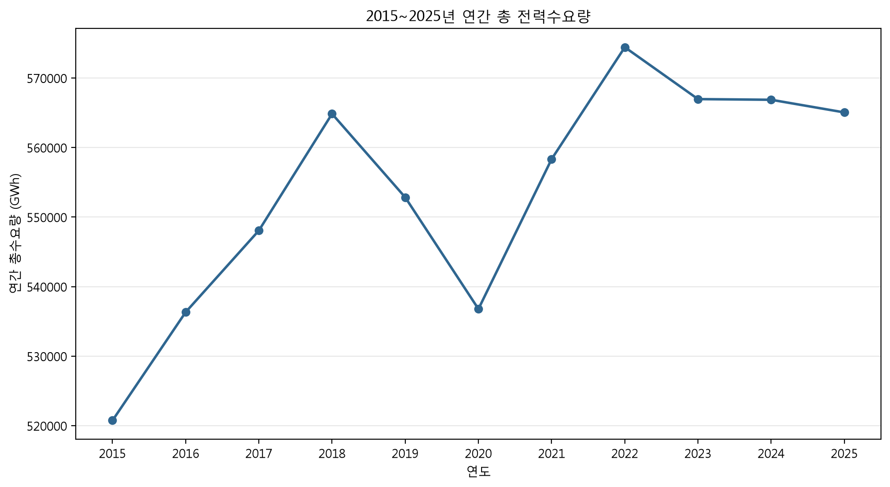
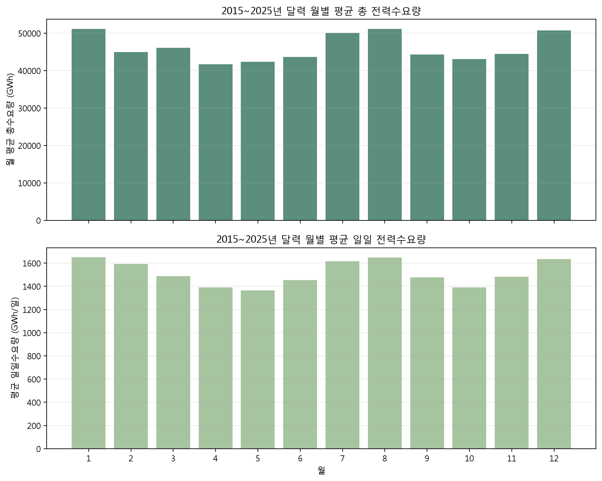
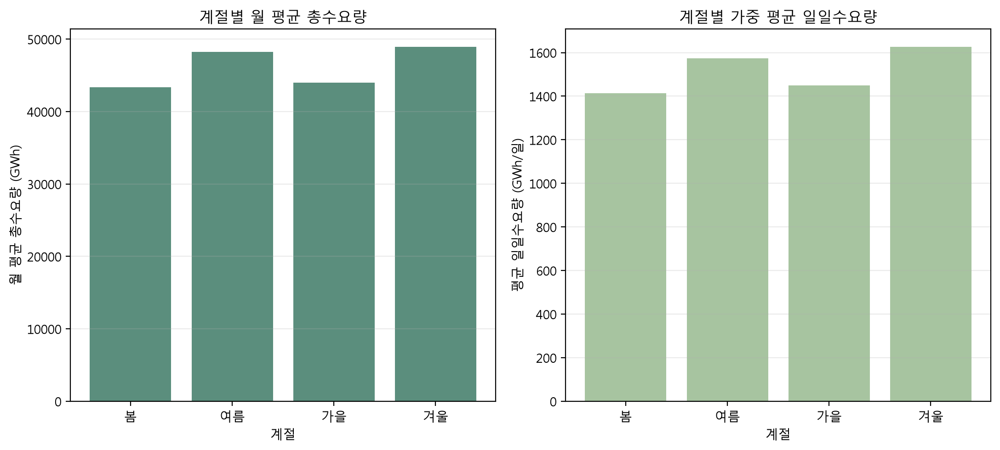
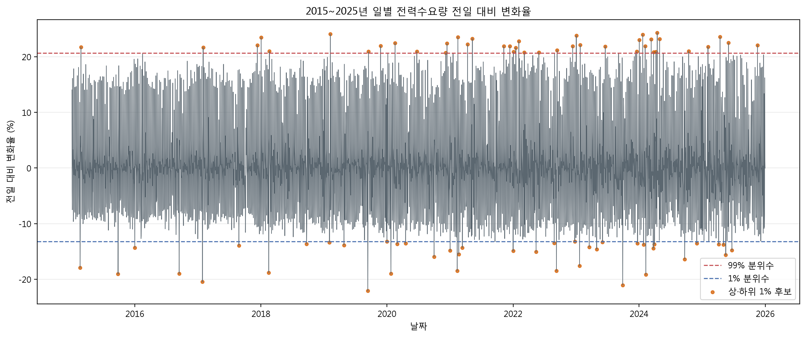
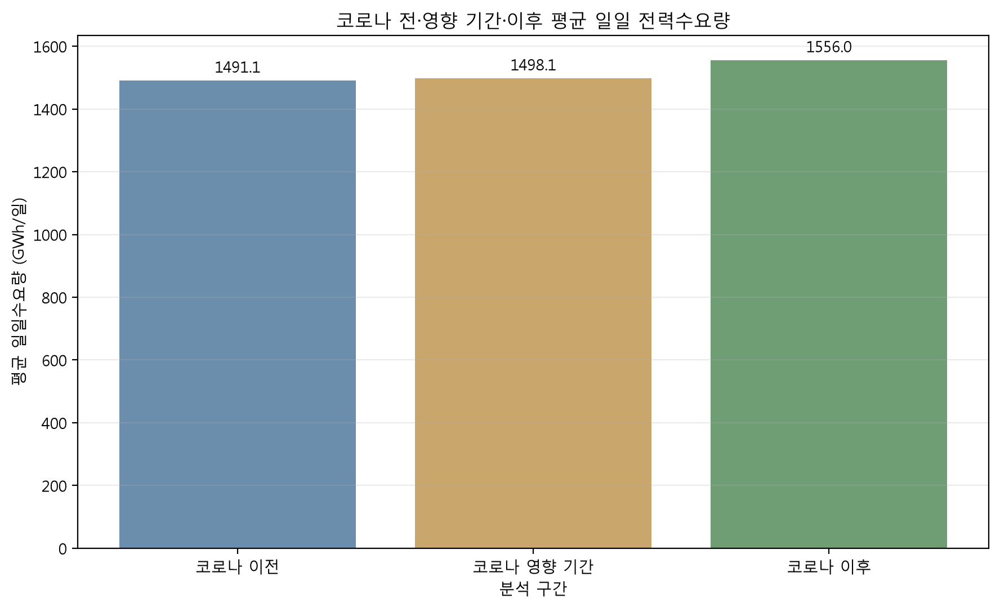
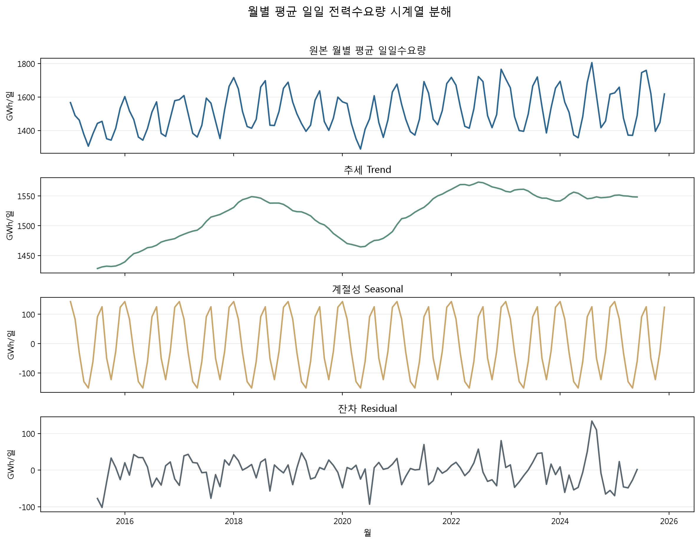
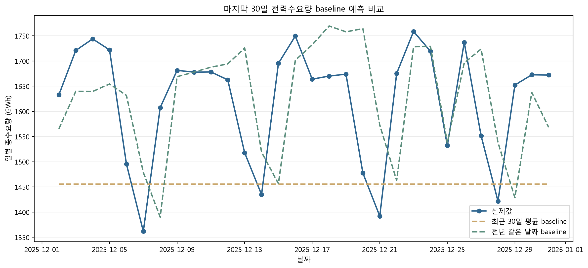

# 대한민국 전체 전력수요량 시계열 분석

> 이 문서는 Mission 7 제출을 위한 최종 분석 보고서이다. 수치와 그래프를 바탕으로 관찰 가능한 사실과 가능한 해석을 구분해 정리했다.

## 1. 분석 주제

한국전력거래소의 시간별 전국 전력수요량을 일별·월별·연별로 집계하여 2015년부터 2025년까지의 장기 추세, 계절성, 급격한 일별 변화, 코로나 전·영향 기간·이후 구간의 차이를 살펴본다.

## 2. 분석 배경 및 목적

전력수요는 시간의 흐름에 따라 변하는 시계열 데이터다. 연도별로 보면 장기적인 증감 방향을 확인할 수 있고, 월별로 보면 반복되는 계절 패턴을 살펴볼 수 있다. 일별 변화율을 계산하면 평소보다 변화 폭이 컸던 날짜도 찾을 수 있다.

이 분석의 목적은 그래프와 기초 통계를 통해 데이터에서 확인할 수 있는 패턴을 정리하는 것이다. 특정 변화의 원인을 확정하기보다는, 추가 데이터로 검토할 수 있는 가설을 제시하는 데 초점을 둔다.

## 3. 분석 질문

1. **질문 1.** 2015~2025년 동안 우리나라 전체 전력수요량의 장기적인 추세는 어떻게 변화했는가?
2. **질문 2.** 우리나라 전력수요량에는 반복되는 계절적 패턴이 나타나는가?
3. **질문 3.** 전력수요량이 평소보다 급격하게 증가하거나 감소한 시점은 언제인가?
4. **질문 4.** 코로나 이전·영향 기간·이후의 전력수요량은 어떻게 달라졌는가?

## 4. 데이터 설명

- **제공 기관:** 한국전력거래소
- **데이터:** 시간별 전국 전력수요량
- **분석 기간:** 2015-01-01~2025-12-31
- **원본 단위:** MWh
- **분석 단위:** 일별·월별·연별 GWh
- **최종 일별 데이터 수:** 4,018일
- **최종 월별 데이터 수:** 132개월
- **최종 연별 데이터 수:** 11년

분석에는 다음 전처리 결과를 사용했다.

- `data/processed/daily_demand.csv`
- `data/processed/monthly_demand.csv`
- `data/processed/yearly_demand.csv`

일별 데이터는 `date`, `year`, `month`, `daily_demand_gwh`, `source_file` 컬럼으로 구성되어 있다. 월별 데이터에는 월 총수요량과 포함 일수가, 연별 데이터에는 연간 총수요량과 포함 일수가 들어 있다.

## 5. 데이터 전처리

원본 파일은 날짜와 `1시`부터 `24시`까지의 시간별 수요량으로 구성되어 있었다. 다음 순서로 전처리했다.

1. 여러 연도 파일을 하나로 통합했다.
2. 날짜를 날짜형으로 변환하고 2015-01-01~2025-12-31만 선택했다.
3. 같은 기간이 겹치는 중간 스냅샷과 연말 최종 파일을 확인한 뒤, 연도별 최종 파일을 사용했다.
4. 24개 시간별 MWh 값을 합산해 일별 총수요량을 계산했다.
5. 일별 합계를 1,000으로 나누어 GWh로 변환했다.
6. 일별 데이터를 월별과 연별로 합산했다.
7. 날짜 연속성, 중복, 결측값과 집계 결과의 일치 여부를 검증했다.

검증 결과, 최종 데이터는 2015-01-01부터 2025-12-31까지 4,018일이 연속적으로 존재했다. 최종 데이터의 결측 날짜와 중복 날짜는 각각 0일이었다. 월별 합계를 다시 연간으로 합산한 값도 일별 데이터를 직접 연간으로 합산한 값과 허용 오차 범위에서 일치했다.

## 6. 분석 방법

### 질문 1. 장기 추세

연간 총수요량을 연도별로 비교했다. 전년 대비 변화량은 해당 연도 총수요량에서 직전 연도 총수요량을 빼서 계산했고, 전년 대비 변화율은 직전 연도 대비 증감 비율로 계산했다. 윤년의 영향을 확인할 수 있도록 연도별 일수도 함께 살펴봤다.

### 질문 2. 계절성

2015~2025년의 같은 달을 묶어 1월부터 12월까지 월 총수요량의 평균을 계산했다. 월마다 28~31일로 길이가 다르므로 `월 총수요량 ÷ 해당 월 일수`로 월별 평균 일일수요량도 계산했다.

계절은 봄 3~5월, 여름 6~8월, 가을 9~11월, 겨울 12~2월로 구분했다. 계절별 평균 일일수요량은 해당 계절 총수요량을 실제 포함 일수로 나눈 가중 평균이다.

### 질문 3. 급격한 변화

각 날짜의 일별 총수요량을 전날과 비교해 변화량과 변화율을 계산했다. 증가율 상위 10일과 감소율 하위 10일을 확인했다. 임의의 고정 기준 대신 전체 변화율 분포의 1% 분위수와 99% 분위수를 사용해 급격한 변화 후보를 표시했다.

### 질문 4. 코로나 구간 비교

다음 세 구간을 임시 기준으로 구분했다.

- 코로나 이전: 2015-01-01~2019-12-31
- 코로나 영향 기간: 2020-01-01~2021-12-31
- 코로나 이후: 2022-01-01~2025-12-31

각 구간의 일수, 총수요량, 평균, 중앙값, 최솟값, 최댓값, 표준편차를 계산했다. 세 구간의 길이가 다르므로 총수요량보다 평균 일일수요량을 중심으로 비교했다.

## 7. 분석 결과

### 7.1 장기 추세 분석



| 연도 | 연간 총수요량(GWh) | 일수 | 전년 대비 변화율 |
|---:|---:|---:|---:|
| 2015 | 520,746.46 | 365 | - |
| 2016 | 536,330.80 | 366 | 2.99% |
| 2017 | 548,064.82 | 365 | 2.19% |
| 2018 | 564,850.13 | 365 | 3.06% |
| 2019 | 552,831.36 | 365 | -2.13% |
| 2020 | 536,780.13 | 366 | -2.90% |
| 2021 | 558,338.40 | 365 | 4.02% |
| 2022 | 574,426.06 | 365 | 2.88% |
| 2023 | 566,964.42 | 365 | -1.30% |
| 2024 | 566,868.58 | 366 | -0.02% |
| 2025 | 565,048.56 | 365 | -0.32% |

**관찰(Fact)**

- 연간 총수요량은 2015년 520,746.46 GWh에서 2025년 565,048.56 GWh로 44,302.10 GWh, 약 8.51% 증가했다. 10년간의 연평균 복합 증가율은 약 0.82%다.
- 2015~2018년에는 매년 증가했지만 2019년에는 2.13%, 2020년에는 2.90% 감소했다.
- 2021년에는 전년 대비 4.02% 증가했고, 2022년에는 분석 기간 중 가장 높은 574,426.06 GWh를 기록했다.
- 2023~2025년에는 각각 -1.30%, -0.02%, -0.32%로 소폭 감소하거나 비슷한 수준을 유지했다.

**해석 가설(Hypothesis)**

- 전체 기간을 보면 전력수요의 장기 수준은 높아졌지만, 매년 일정하게 증가한 것은 아니다.
- 연도별 증감에는 산업활동, 기온, 인구·경제 구조, 에너지 효율 등의 요인이 함께 영향을 주었을 가능성이 있다. 현재 데이터만으로 각 요인의 기여도를 구분할 수는 없다.

### 7.2 계절성 분석





| 계절 | 월 관측 수 | 포함 일수 | 월 평균 총수요량(GWh) | 가중 평균 일일수요량(GWh/일) |
|:---:|---:|---:|---:|---:|
| 봄 | 33 | 1,012 | 43,385.16 | 1,414.73 |
| 여름 | 33 | 1,012 | 48,273.62 | 1,574.14 |
| 가을 | 33 | 1,001 | 43,976.63 | 1,449.78 |
| 겨울 | 33 | 993 | 48,947.92 | 1,626.67 |

**관찰(Fact)**

- 달력 월별 평균 일일수요량은 1월이 1,650.14 GWh/일로 가장 높았고, 8월이 1,648.43 GWh/일로 비슷하게 높았다.
- 12월은 1,635.70 GWh/일, 7월은 1,615.48 GWh/일로 나타났다.
- 평균 일일수요량이 가장 낮은 달은 5월 1,365.17 GWh/일이었고, 10월도 1,390.75 GWh/일로 낮았다.
- 계절별 가중 평균 일일수요량은 겨울 1,626.67 GWh/일, 여름 1,574.14 GWh/일, 가을 1,449.78 GWh/일, 봄 1,414.73 GWh/일 순이었다.
- 겨울의 평균 일일수요량은 봄보다 211.93 GWh/일, 약 14.98% 높았다. 여름은 봄보다 159.41 GWh/일, 약 11.27% 높았다.

**해석 가설(Hypothesis)**

- 겨울과 여름에 높고 봄과 가을에 낮은 반복 패턴이 나타났다.
- 기온 변화에 따른 난방·냉방 관련 전력 사용이 이러한 패턴과 관련되었을 가능성이 있다. 다만 이 분석에는 기온이나 용도별 전력사용량이 포함되지 않았으므로 냉난방 수요가 원인이라고 단정할 수 없다.

### 7.3 급격한 변화 분석



| 통계량 | 전일 대비 변화율 |
|:---|---:|
| 평균 | 0.330% |
| 표준편차 | 8.204% |
| 최솟값 | -22.113% |
| 1% 분위수 | -13.240% |
| 5% 분위수 | -10.927% |
| 95% 분위수 | 17.429% |
| 99% 분위수 | 20.690% |
| 최댓값 | 24.324% |

변화율 절댓값이 아니라 증가와 감소를 따로 정렬했다. 다음 표는 각각 변화 폭이 가장 큰 5개 날짜다.

| 구분 | 날짜 | 전일 수요량(GWh) | 당일 수요량(GWh) | 변화량(GWh) | 변화율 |
|:---:|:---:|---:|---:|---:|---:|
| 증가 | 2024-04-15 | 1,176.785 | 1,463.030 | 286.245 | 24.324% |
| 증가 | 2019-02-07 | 1,240.426 | 1,538.824 | 298.398 | 24.056% |
| 증가 | 2024-01-22 | 1,462.966 | 1,813.767 | 350.801 | 23.979% |
| 증가 | 2023-01-02 | 1,441.001 | 1,783.897 | 342.896 | 23.796% |
| 증가 | 2025-04-14 | 1,224.536 | 1,513.237 | 288.701 | 23.576% |
| 감소 | 2019-09-12 | 1,560.105 | 1,215.126 | -344.979 | -22.113% |
| 감소 | 2023-09-28 | 1,541.545 | 1,217.045 | -324.500 | -21.050% |
| 감소 | 2017-01-27 | 1,652.895 | 1,314.356 | -338.539 | -20.482% |
| 감소 | 2024-02-09 | 1,608.728 | 1,300.414 | -308.314 | -19.165% |
| 감소 | 2015-09-26 | 1,357.914 | 1,099.126 | -258.788 | -19.058% |

**관찰(Fact)**

- 4,017개의 전일 대비 변화율 중 하위 1% 기준은 -13.240%, 상위 1% 기준은 20.690%였다.
- 이 기준으로 감소 후보 41일과 증가 후보 41일, 총 82일을 확인했다.
- 가장 큰 증가는 2024-04-15의 24.324%였고, 가장 큰 감소는 2019-09-12의 -22.113%였다.
- 상위 증가일과 감소일의 대표 사례에는 1~2월, 4월, 9월의 날짜가 포함되어 있었다.

**해석 가설(Hypothesis)**

- 일부 큰 감소와 이후 증가는 명절이나 연휴 전후의 산업·상업 활동 변화와 관련되었을 가능성이 있다.
- 그러나 공휴일·대체휴일·연휴 정보를 데이터에 결합하지 않았으므로 해당 날짜가 명절 효과 때문이라고 확정할 수 없다. 날씨와 산업활동 같은 다른 변수도 함께 확인해야 한다.

### 7.4 코로나 전후 비교



| 구간 | 일수 | 총수요량(GWh) | 평균 일일수요량(GWh/일) | 중앙값 | 최솟값 | 최댓값 | 표준편차 |
|:---|---:|---:|---:|---:|---:|---:|---:|
| 코로나 이전 | 1,826 | 2,722,823.57 | 1,491.14 | 1,482.32 | 976.42 | 1,914.48 | 156.99 |
| 코로나 영향 기간 | 731 | 1,095,118.53 | 1,498.11 | 1,491.53 | 1,046.33 | 1,923.60 | 165.55 |
| 코로나 이후 | 1,461 | 2,273,307.62 | 1,555.99 | 1,539.51 | 1,089.15 | 1,996.87 | 183.00 |

**관찰(Fact)**

- 평균 일일수요량은 코로나 이전 1,491.14 GWh/일, 영향 기간 1,498.11 GWh/일, 이후 1,555.99 GWh/일이었다.
- 영향 기간의 평균은 이전보다 6.97 GWh/일, 약 0.47% 높았다.
- 이후 구간의 평균은 영향 기간보다 57.88 GWh/일, 약 3.86% 높았으며 이전보다 64.85 GWh/일, 약 4.35% 높았다.
- 일별 수요량의 표준편차는 이전 156.99 GWh, 영향 기간 165.55 GWh, 이후 183.00 GWh로 나타났다.
- 구간별 총수요량은 기간 길이가 1,826일, 731일, 1,461일로 다르기 때문에 직접적인 크기 비교에는 적합하지 않다.

**해석 가설(Hypothesis)**

- 세 구간의 평균 일일수요량과 변동성에는 차이가 있었다.
- 이 차이가 코로나의 직접적인 영향이라고 단정할 수 없다. 구간별 연도 구성, 기온, 산업구조, 경제활동과 장기 추세가 함께 반영되었을 수 있다.

## 8. 보너스 분석: 시계열 분해와 간단 예측

### 8.1 시계열 분해



**사용 데이터와 방법**

- 사용 데이터: `monthly_demand.csv`의 월별 평균 일일수요량
- 계산 방식: `monthly_demand_gwh ÷ day_count`
- 분해 방법: additive seasonal decomposition
- 계절 주기: 12개월
- 분석 기간: 2015-01~2025-12, 총 132개월

시계열 분해는 하나의 시계열을 관찰값, 추세, 계절성, 잔차로 나누어 보는 방법이다. 여기서는 월별 총수요량을 그대로 사용하지 않고 월별 평균 일일수요량을 사용했다. 월마다 일수가 다르기 때문에 총수요량만 비교하면 월 길이 차이가 섞일 수 있기 때문이다.

분해 결과에서 trend와 residual은 각각 12개의 NaN이 발생했다. 이는 이동평균 방식으로 추세를 계산할 때 시계열의 앞뒤 일부 구간에서 값이 계산되지 않는 일반적인 현상이다.

**관찰(Fact)**

- 2015-01부터 2025-12까지 132개월이 연속적으로 존재해 월별 분해에 사용할 수 있었다.
- 계절성 성분이 평균적으로 크게 나타난 달은 1월 143.264, 8월 125.585, 12월 123.944였다.
- 계절성 성분이 평균적으로 작게 나타난 달은 5월 -150.800, 4월 -129.109, 10월 -122.198이었다.
- 분해 결과에서 장기적인 추세 성분과 달마다 반복되는 계절성 성분을 분리해 확인할 수 있었다.

**해석 가설(Hypothesis)**

- 겨울과 여름에 계절성 성분이 높고 봄과 가을에 낮은 반복 패턴이 분리되어 관찰된다.
- 다만 이 결과만으로 계절성의 원인을 냉난방 수요라고 단정할 수 없다. 기온, 공휴일, 산업활동 같은 외부 변수를 함께 확인해야 원인 해석이 가능하다.

**한계**

- 월별 평균 일일수요량만 사용했으므로 하루 안의 시간대별 패턴은 확인하지 못한다.
- 기온, 공휴일, 산업활동 변수는 포함하지 않았다.
- additive 분해는 패턴이 더해지는 방식이라는 가정을 사용하므로 실제 전력수요 구조를 완전히 설명한다고 볼 수는 없다.

### 8.2 Baseline 예측



**사용 데이터와 방법**

- 사용 데이터: `daily_demand.csv`의 일별 총수요량
- 테스트 구간: 2025-12-02~2025-12-31, 총 30일
- Baseline A: 테스트 직전 30일 평균을 테스트 기간 전체의 예측값으로 사용
- Baseline B: 테스트 날짜별 전년 같은 날짜의 값을 예측값으로 사용

이 분석은 복잡한 예측 모델을 만드는 것이 아니라, 단순한 기준선 예측을 통해 예측이 어떤 가정 위에서 이루어지는지 확인하기 위한 것이다.

| Baseline | 평가 일수 | MAE(GWh) | MAPE(%) | RMSE(GWh) |
|:---|---:|---:|---:|---:|
| 최근 30일 평균 | 30 | 180.295 | 10.797 | 200.813 |
| 전년 같은 날짜 | 30 | 103.125 | 6.530 | 129.980 |

**관찰(Fact)**

- 마지막 30일 테스트 구간에서는 전년 같은 날짜 baseline의 MAE, MAPE, RMSE가 모두 최근 30일 평균 baseline보다 낮았다.
- 최근 30일 평균 baseline의 MAE는 180.295 GWh였고, 전년 같은 날짜 baseline의 MAE는 103.125 GWh였다.
- 전년 같은 날짜 baseline의 MAPE는 6.530%로, 최근 30일 평균 baseline의 10.797%보다 낮았다.

**해석 가설(Hypothesis)**

- 테스트 기간에서는 전년 같은 날짜를 기준으로 삼는 방식이 최근 30일 평균보다 실제값에 더 가까웠다.
- 이는 전력수요에 연 단위 반복 패턴이 일부 존재할 가능성을 보여준다. 다만 이 결과는 마지막 30일에 대한 비교일 뿐이며, 다른 기간에서도 항상 같은 결과가 나온다고 볼 수는 없다.

**한계**

- 테스트 기간이 30일로 짧아 예측 성능을 일반화하기 어렵다.
- 두 baseline 모두 기온, 요일, 공휴일, 산업활동 같은 설명 변수를 사용하지 않는다.
- 이 결과는 실제 미래 예측 모델의 성능이라기보다, 더 복잡한 모델과 비교할 수 있는 단순 기준선으로 보는 것이 적절하다.

## 9. 질문별 최종 답변

### 질문 1. 2015~2025년 동안 우리나라 전체 전력수요량의 장기적인 추세는 어떻게 변화했는가?

2015년부터 2025년까지 전국 전력수요량은 전체적으로 증가했지만, 매년 일정하게 증가한 것은 아니었다. 연간 총수요량은 2015년 520,746.46 GWh에서 2025년 565,048.56 GWh로 약 8.51% 증가했다. 2015~2018년에는 증가세가 이어졌지만, 2019년과 2020년에는 각각 -2.13%, -2.90% 감소했다. 이후 2021년과 2022년에는 다시 증가했고, 2022년에 574,426.06 GWh로 분석 기간 중 가장 높은 값을 기록했다. 2023~2025년에는 소폭 감소하거나 비슷한 수준을 유지했다.

따라서 장기적으로는 전력수요 수준이 높아졌지만, 단순한 직선형 증가가 아니라 감소와 회복, 정체가 함께 나타난 흐름으로 해석하는 것이 적절하다.

---

### 질문 2. 우리나라 전력수요량에는 반복되는 계절적 패턴이 나타나는가?

전국 전력수요량에는 반복되는 계절적 패턴이 나타났다. 계절별 평균 일일수요량은 겨울 1,626.67 GWh/일, 여름 1,574.14 GWh/일, 가을 1,449.78 GWh/일, 봄 1,414.73 GWh/일 순이었다. 월별로는 1월과 8월의 평균 일일수요량이 높았고, 5월과 10월은 상대적으로 낮았다.

따라서 전력수요량은 겨울과 여름에 높고 봄과 가을에 낮은 패턴을 반복하는 것으로 볼 수 있다. 다만 이 분석에는 기온, 용도별 전력사용량, 산업활동 데이터가 포함되지 않았으므로 계절 패턴의 원인을 냉난방 수요로 단정할 수는 없다.

---

### 질문 3. 전력수요량이 평소보다 급격하게 증가하거나 감소한 시점은 언제인가?

전일 대비 변화율을 기준으로 급격한 변화 후보를 확인한 결과, 상위 1% 기준은 20.690%, 하위 1% 기준은 -13.240%였다. 이 기준에 해당하는 후보는 증가 41일, 감소 41일로 총 82일이었다.

가장 큰 증가는 2024-04-15로, 전일 대비 24.324% 증가했다. 가장 큰 감소는 2019-09-12로, 전일 대비 -22.113% 감소했다. 그 외에도 2019-02-07, 2024-01-22, 2023-01-02, 2025-04-14 등이 큰 증가 후보로 나타났고, 2023-09-28, 2017-01-27, 2024-02-09, 2015-09-26 등이 큰 감소 후보로 나타났다.

따라서 급격한 변화 시점은 일부 날짜에서 뚜렷하게 확인되지만, 이 날짜들을 바로 이상치나 특정 원인의 결과로 확정할 수는 없다. 명절, 연휴, 날씨, 산업활동 자료를 추가로 결합해야 원인 검증이 가능하다.

---

### 질문 4. 코로나 이전·영향 기간·이후의 전력수요량은 어떻게 달라졌는가?

코로나 이전, 영향 기간, 이후 구간을 비교한 결과 평균 일일수요량은 코로나 이전 1,491.14 GWh/일, 코로나 영향 기간 1,498.11 GWh/일, 코로나 이후 1,555.99 GWh/일이었다. 코로나 영향 기간의 평균은 이전보다 약 0.47% 높았고, 코로나 이후 구간은 이전보다 약 4.35% 높았다. 표준편차도 코로나 이전 156.99 GWh, 영향 기간 165.55 GWh, 이후 183.00 GWh로 증가했다.

따라서 구간별 평균과 변동성에는 차이가 있었다. 하지만 이 결과는 코로나가 전력수요 변화를 직접 일으켰다는 의미가 아니라, 구간별 기술통계 결과로 해석해야 한다. 기온, 산업활동, 경제 상황, 장기 추세 등이 함께 영향을 주었을 수 있기 때문에 인과관계는 확인할 수 없다.


## 10. 주요 인사이트

### 인사이트 1. 장기적으로 수요 수준은 높아졌지만 증가 경로는 일정하지 않았다

- **관찰(Fact):** 연간 총수요량은 2015년 520,746.46 GWh에서 2025년 565,048.56 GWh로 약 8.51% 증가했다. 그러나 2019년 -2.13%, 2020년 -2.90% 감소한 뒤 2021년 4.02%, 2022년 2.88% 증가했고, 2023~2025년에는 다시 소폭 감소했다.
- **해석 가설(Hypothesis):** 전력수요는 장기적으로 높아졌지만 단순한 직선형 증가가 아니라 여러 외부 요인의 영향을 받으며 변한 것으로 보인다. 연도별 원인을 설명하려면 경제·산업·기온 자료를 추가해야 한다.

### 인사이트 2. 겨울·여름이 높고 봄·가을이 낮은 계절 패턴이 반복되었다

- **관찰(Fact):** 계절별 평균 일일수요량은 겨울 1,626.67 GWh/일, 여름 1,574.14 GWh/일, 가을 1,449.78 GWh/일, 봄 1,414.73 GWh/일이었다. 겨울은 봄보다 약 14.98%, 여름은 봄보다 약 11.27% 높았다.
- **해석 가설(Hypothesis):** 계절별 기온과 난방·냉방 관련 사용이 이 패턴과 관련되었을 가능성이 있다. 기온 및 용도별 자료가 없으므로 원인으로 확정하지 않는다.

### 인사이트 3. 일별 변화율의 양쪽 꼬리에서 반복적으로 큰 변화가 나타났다

- **관찰(Fact):** 변화율의 1% 분위수는 -13.240%, 99% 분위수는 20.690%였고, 양쪽 기준에 해당하는 후보는 각각 41일이었다. 최대 증가는 24.324%, 최대 감소는 -22.113%였다.
- **해석 가설(Hypothesis):** 후보 날짜 중 일부는 명절·연휴 전후의 활동 변화와 연결될 가능성이 있다. 공휴일 달력과 산업활동 자료를 결합해야 이 가설을 검증할 수 있다.

### 인사이트 4. 코로나 구간 구분에 따라 평균과 변동성이 달랐지만 인과관계는 확인되지 않았다

- **관찰(Fact):** 평균 일일수요량은 코로나 이전 1,491.14 GWh/일, 영향 기간 1,498.11 GWh/일, 이후 1,555.99 GWh/일이었다. 이후 구간은 이전보다 약 4.35% 높았다. 표준편차도 156.99 GWh에서 183.00 GWh로 차이가 있었다.
- **해석 가설(Hypothesis):** 구간 간 차이에는 코로나뿐 아니라 장기 추세, 기온, 산업활동, 구간별 연도 구성 등이 함께 작용했을 수 있다. 따라서 이 결과는 구간 차이에 대한 기술통계로 해석해야 한다.

## 11. 한계점

1. **외부 변수 미포함:** 기온, 습도, 산업생산, 경제성장률, 인구, 전기요금 등 수요 변화와 관련될 수 있는 변수를 사용하지 않았다.
2. **공휴일 정보 미포함:** 급격한 변화 후보에 명절·연휴 가능성을 제시했지만 공휴일 달력과 결합하지 않아 이를 검증하지 못했다.
3. **인과관계 판단 불가:** 코로나 전·영향 기간·이후 구간의 차이는 확인했지만 코로나가 원인이라는 인과관계를 검증한 분석은 아니다.
4. **구간 길이 차이:** 코로나 비교 구간의 일수가 서로 달라 총수요량을 직접 비교하기 어렵다. 평균 일일수요량도 구간별 연도 구성의 영향을 받을 수 있다.
5. **전국 합계의 한계:** 전국 총수요량만 사용했으므로 지역별·산업별·가정용·상업용 차이는 확인할 수 없다.
6. **일별 집계의 한계:** 시간별 자료를 일별로 합산했기 때문에 하루 안에서 발생한 최대부하 시간이나 시간대별 변화는 분석하지 않았다.
7. **계절 정의:** 계절을 고정된 달력 월로 나눴기 때문에 실제 기상학적 계절 변화와 정확히 일치하지 않을 수 있다.

## 12. 결론

2015~2025년 전국 전력수요량에는 장기적인 수준 변화와 반복되는 월별·계절별 패턴이 함께 나타났다. 일부 날짜에는 전일 대비 20% 안팎의 큰 변화도 관찰되었다. 코로나 전·영향 기간·이후로 나눈 구간의 평균 일일수요량과 변동성에도 차이가 있었다.

다만 이 분석은 전력수요 데이터 자체에서 확인할 수 있는 패턴을 정리한 것이다. 각 변화의 원인을 설명하려면 기온, 공휴일, 산업활동과 같은 외부 자료를 추가해 비교해야 한다. 따라서 현재 결과는 최종적인 원인 결론이 아니라 추가 분석을 위한 근거로 보는 것이 적절하다.

## 13. AI 활용 및 검증

### AI 활용 작업

- 여러 연도 CSV의 구조와 인코딩 확인
- 데이터 전처리 코드 작성 보조
- 일별·월별·연별 집계 코드 작성 보조
- 질문 1~4 계산 및 시각화 코드 작성 보조
- 보너스 시계열 분해와 baseline 예측 코드 작성 보조
- 결과표를 바탕으로 한 보고서 초안 작성과 문장 정리

### AI를 사용한 이유

- 반복적인 데이터 점검과 집계 코드 작성 시간을 줄이기 위해 사용했다.
- 분석 질문별로 필요한 통계량과 시각화 방법의 대안을 검토하기 위해 사용했다.
- 관찰한 사실과 해석 가설을 구분하는 보고서 구조를 만드는 데 활용했다.

### 검증 방법

- 실제 CSV의 컬럼, 인코딩, 행 수와 날짜 범위를 직접 확인했다.
- 2015-01-01~2025-12-31의 4,018개 날짜가 연속적으로 존재하는지 확인했다.
- 결측 날짜와 최종 중복 날짜가 0일인지 확인했다.
- 일별→월별→연별 합계가 허용 오차 범위에서 일치하는지 독립적으로 다시 계산했다.
- 질문 1~4 결과 CSV를 다시 읽어 그래프와 보고서 수치가 일치하는지 대조했다.
- 생성된 필수 분석 PNG 5개와 보너스 PNG 2개를 열어 한글, 축, 단위, 범례와 레이아웃이 정상인지 확인했다.
- 외부 데이터가 없는 원인 설명은 사실이 아니라 가설로 표시했다.

### 재현 방법

```powershell
python preprocess_power_demand.py --input-dir "원본 CSV 폴더" --output-dir "data/processed"
python analysis_power_demand.py --data-dir "data/processed" --results-dir "results"
python bonus_time_series_analysis.py --data-dir "data/processed" --results-dir "results"
```

필요한 라이브러리는 `requirements.txt`에서 확인할 수 있다.
